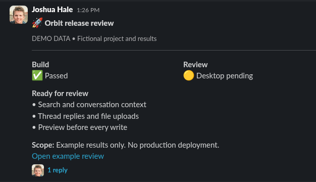
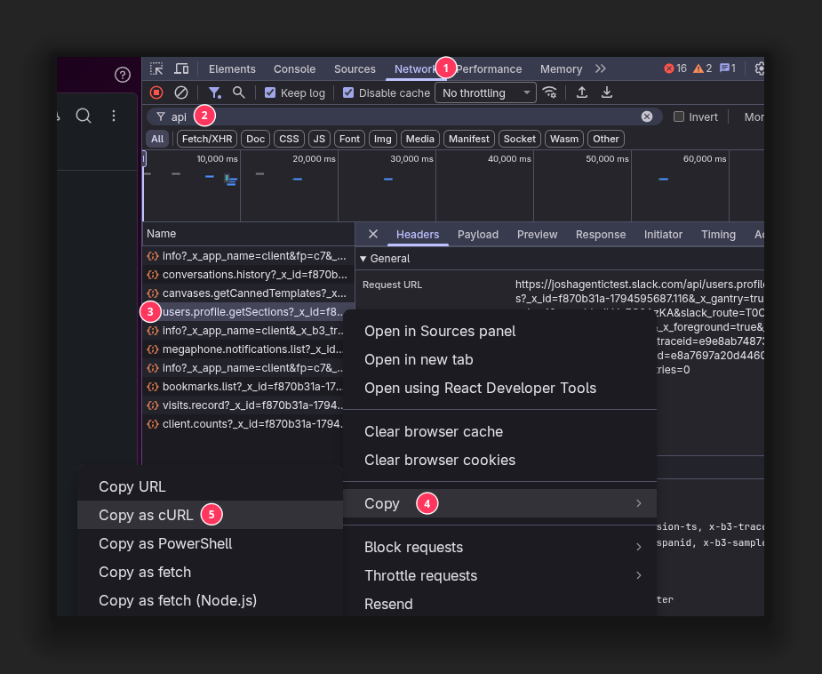
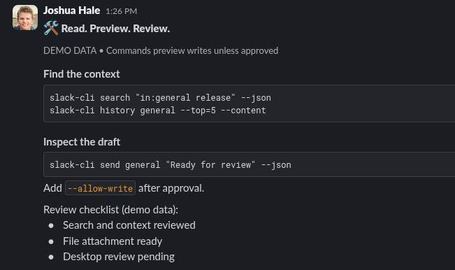
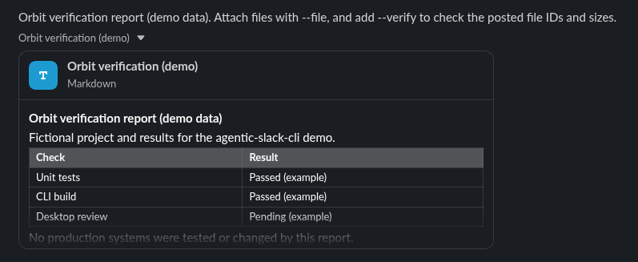
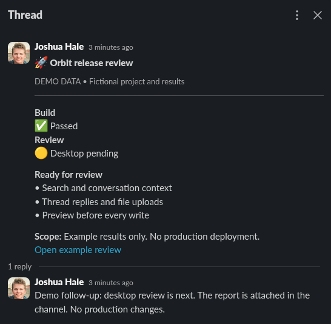

<h1 align="center">agentic-slack-cli</h1>

<p align="center">
  <strong>Slack, from your terminal.</strong>
</p>

<p align="center">
  <a href="#suggested-agent-instructions">Try it with your agent</a> ·
  <a href="#quick-start">Quick start</a> ·
  <a href="#rich-messages">Rich messages</a> ·
  <a href="#files-and-threads">Files and threads</a> ·
  <a href="#for-coding-agents">For agents</a> ·
  <a href="#updates">Updates</a> ·
  <a href="#command-reference">Commands</a>
</p>

A Slack CLI for coding agents and terminal use. Read conversations, search
messages, send files, and post formatted updates like the one below.

Commands that change Slack show a preview first. Add `--allow-write` to send
the request.

<p align="center">
  
  <br><sub>Sent from the CLI using Block Styling</sub>
</p>

## Suggested agent instructions

Copy a prompt into your coding agent after installing and signing in.

<table>
<tr>
<td width="50%" valign="top">
<h3>💬 Answer a question</h3>
<pre><code>Use slack-cli to help me respond to the
question in #engineering.</code></pre>
<br>
</td>
<td width="50%" valign="top">
<h3>🗓️ Catch up</h3>
<pre><code>Summarize what I missed last week with
slack-cli.</code></pre>
<br>
</td>
</tr>
<tr>
<td width="50%" valign="top">
<h3>✉️ Draft a DM</h3>
<pre><code>Draft a DM with slack-cli to Randy about
the product launch. Search #product for
context.</code></pre>
<br>
</td>
<td width="50%" valign="top">
<h3>🚀 Write a release update</h3>
<pre><code>Use slack-cli to draft a release update
with status fields and a checklist from
the discussion in #engineering.</code></pre>
<br>
</td>
</tr>
<tr>
<td colspan="2">
<h3>📎 Share a report</h3>
<pre><code>Use slack-cli to attach report.pdf to the release thread. Show me
the file and destination before uploading.</code></pre>
<br>
</td>
</tr>
</table>

Review the draft before letting your agent add `--allow-write` to send it.

```sh
slack-cli history general --top=10
slack-cli send general "Ready for review"
# Review the content and destination, then approve the send:
slack-cli send general "Ready for review" --allow-write
```

> This tool uses your Slack browser session without an OAuth app.
> Slack changes can break it. Your workspace policies and account permissions
> still apply.

## Install

### MacOS & Linux

```sh
curl -fsSLO https://raw.githubusercontent.com/LegoGuy32109/agentic-slack-cli/master/install.sh
sh install.sh
```

The installer uses `~/.local/bin`. Add that folder to your PATH if needed.

### Windows PowerShell

Open PowerShell and paste these commands. Administrator access is not required.

```powershell
Invoke-WebRequest -UseBasicParsing `
  https://raw.githubusercontent.com/LegoGuy32109/agentic-slack-cli/master/install.ps1 `
  -OutFile install.ps1
powershell -NoProfile -ExecutionPolicy Bypass -File .\install.ps1
```

The installer uses `%LOCALAPPDATA%\slack-cli\bin` and adds it to your user PATH.
Open a new terminal to start using it.

The execution-policy option applies only to this installer process.

Both installers verify the binary's SHA-256 checksum before installing it.

<details>
<summary>Platforms and manual installation</summary>

Release binaries run without Bun or Node.js. You can also download one from
[Releases](https://github.com/LegoGuy32109/agentic-slack-cli/releases/latest).

| Machine | Release asset |
| --- | --- |
| Linux x64 | `slack-cli-linux-x64` |
| macOS Apple silicon | `slack-cli-mac-arm64` |
| Windows x64 | `slack-cli-windows-x64.exe` |

For manual installation, download the executable and `SHA256SUMS` from the same
release and verify the checksum. On Windows, rename it to `slack-cli.exe` and
place it in a folder on your PATH.

Prebuilt binaries support Linux x64, Apple silicon macOS, and Windows x64.
Intel Mac users can build from source. There are no native Linux ARM64 or
Windows ARM64 builds. On Windows ARM64,
the installer uses the x64 build through emulation.

Set `SLACK_CLI_BIN` to choose another folder for the macOS/Linux installer.

</details>

## Quick start

Open your Slack workspace in a browser, then open DevTools. Follow the numbers
in the screenshot:

1. Select **Network**.
2. Filter requests by `api/`.
3. Right-click a Slack API request.
4. Open the **Copy** submenu.
5. Select **Copy as cURL**.

<p align="center">
  
  <br><sub>Copy the request, then paste it into the local auth command</sub>
</p>

Run the authentication command below, paste the copied request, and press
Ctrl+D to finish. Keep the copied request out of chats, issues, and screenshots.

```sh
slack-cli auth --profile demo
slack-cli auth status --profile demo
slack-cli history general --top=5 --profile demo
```

The CLI saves the browser tokens locally. Run `auth` again when the session
expires. [Credentials and profiles](docs/credentials.md) covers storage paths
and environment overrides, including local `.env` files.

Start with a preview:

```sh
slack-cli send general "First draft" --profile demo --json
```

Use a channel ID, its visible name, or `#name` as the destination. For a DM, use
the conversation ID, not the person's user ID. List the conversations you can
access with:

```sh
slack-cli api conversations.list --params '{"limit":200}'
```

## Rich messages

`--format=rich` turns consecutive `-` or `*` lines into native Slack bullet
lists. Other lines stay as text sections.

```sh
slack-cli send general 'Review checklist:
- Tests passed
- Desktop review pending' --format=rich
```

To combine headings, status fields, and code blocks in one message, use
`--blocks`. Slack calls these layouts
[Block Kit](https://docs.slack.dev/block-kit/).
A JSON file defines the layout, and Slack renders it as a message. Your agent
can write that file or adapt one of the examples here, then send it through
the CLI using your browser session.

Pass the file with `--blocks @file.json` and include a text fallback for
notifications:

```sh
slack-cli send general "Demo release: checks passed, desktop review pending." \
  --blocks @examples/release-blocks.json --json
```

<p align="center">
  
  <br><sub>Code blocks and a native checklist in Slack</sub>
</p>

The [release example](examples/release-blocks.json) uses a heading, status
fields, a review checklist, and a labeled link. The [code
example](examples/code-blocks.json) uses a fenced command block and an inline
command.

| You want | Use |
| --- | --- |
| Native bullet lists | `--format=rich` |
| A structured layout | `--blocks @message.json` |
| A real person mention | `@{Display Name}` in message text |
| An attachment | `--file report.md` |
| A reply | `--thread-ts ROOT_TS` |

In a `mrkdwn` block, use `<https://example.com/review|Open review>` for a
labeled link.

Use `@{Name}` to mention a person in message text. The CLI refuses missing or
ambiguous matches and warns if you type a plain `@Name`. For mentions inside raw
blocks, supply the Slack user ID yourself.

The [examples and screenshot notes](docs/showcase.md) include the source files
and commands for these messages.

## Files and threads

Repeat `--file` to attach several files with one comment. Use `--title` values
in the same order as the attachments to give each file a title.

```sh
slack-cli send general "Demo verification report" \
  --file examples/demo-report.md --title "Demo verification" --json

# After approval, upload and check the posted file IDs and sizes:
slack-cli send general "Demo verification report" \
  --file examples/demo-report.md --title "Demo verification" \
  --verify --allow-write
```

<p align="center">
  
  <br><sub>A Markdown file uploaded with --file and rendered by Slack</sub>
</p>

The preview shows each file's path, size, SHA-256, and first line when
available. Nothing uploads until you add `--allow-write`. The CLI rejects empty
files and files larger than 1 GiB. `--verify` reads the posted message back to
check file IDs and sizes. It does not download the files to compare their
contents. File uploads use Slack's initial-comment field, which cannot take
`--blocks` or `--format=rich`.

Use the root message timestamp for a thread reply:

```sh
slack-cli send general "Desktop review is next." --thread-ts 1710000000.000001
```

<details>
<summary>See the thread reply</summary>

<p align="center">
  
  <br><sub>A follow-up sent with --thread-ts</sub>
</p>

</details>

Deleting a message leaves its uploaded files in Slack. Use `api files.delete` to
preview or delete the file separately.

## Edit a message

```sh
slack-cli edit general 1710000000.000001 \
  "Updated: desktop review passed." --json
```

Use `edit` to change your own messages, with the same `--blocks` and
`--format=rich` options as `send`. Both commands return a message timestamp and
a permalink when Slack supplies one.

## For coding agents

Read commands support `--json`. Use `--content` to include visible block and
attachment text when reading messages. Search results include an `id` in
`channelId:ts` format that `context` accepts directly.

```sh
slack-cli search 'in:general release' --count=10 --json
slack-cli context C123:1710000000.000001 --window=4 --content --json
slack-cli unread --content --json
```

`unread` includes channels, group DMs, DMs, followed threads, and file links.
Add `--all` to include muted conversations. Reading does not mark messages read.

### Unreads

Use the `request_ts` from an unread scan as an explicit read boundary:

```sh
slack-cli mark 1710000000.000001 --only general
# After reviewing the preview:
slack-cli mark 1710000000.000001 --only general --allow-write
```

`mark` checks the unread state again and marks conversations and followed
threads through the supplied timestamp. It never advances past that boundary.
Use `--ignore general` to exclude destinations. Choose either `--only` or
`--ignore`.

If you have already read further in Slack, `mark` can move that read position
backward. The command reports individual failures and continues with the
remaining conversations and threads.

Search accepts Slack modifiers such as `in:general`, `from:me`, and
`on:2026-11-13`. `--after` and `--before` add Slack's exclusive date filters. To
search mentions of someone, include `@handle`, `@{Display Name}`, or `<@USERID>`
in the query. Slack resolves these names server-side, so prefer a unique handle
when names collide.

## Slack Lists

Inspect accessible Lists, filter rows, update a typed cell, or reorder a row. A
List reference can be its URL, ID, or exact title.

```sh
slack-cli lists list
slack-cli lists schema "Demo tracker"
slack-cli lists rows "Demo tracker" --where Status=Pending
slack-cli lists update "Demo tracker" --where Task=Docs \
  --column Status --value Done
slack-cli lists move "Demo tracker" --where Task=Docs --after Task=Build
```

After an approved update or move, the CLI reads the List again to check the
result. Supported cell types include text, number, date, user, select, and
checkbox. List access depends on your workspace and permissions.

## Direct API access

Look up a method and its required parameters before calling it:

```sh
slack-cli api methods
slack-cli api describe chat.update
slack-cli api conversations.replies \
  --params '{"channel":"general","ts":"1710000000.000001"}'
slack-cli api reactions.add --params '{
  "channel":"general",
  "timestamp":"1710000000.000001",
  "name":"white_check_mark"
}'
```

`--params` accepts inline JSON or `@file.json`. The CLI encodes arrays and
objects for Slack's form transport.

For a method outside the catalog, add `--unsafe-method` to preview it. Running
it also requires `--allow-write`. Some Slack endpoints may reject browser
credentials.

## Updates

Check for a release or install it:

```sh
slack-cli update --check
slack-cli update
slack-cli version
```

The CLI downloads the matching release from GitHub and checks `SHA256SUMS`
before replacing itself. A failed checksum leaves the existing binary in place.
Updates keep your credentials and caches. Use `--force` to permit a downgrade.

On Windows, run `slack-cli version` after the update command exits to check
that replacement finished.

Checksums detect corruption but do not independently verify publisher identity.

Source changes reach installed users after a new release. The maintainer
workflow is in [release maintenance](docs/maintenance.md).

## Command reference

Run `slack-cli --help` for command syntax and common flags. See the [full
reference](docs/commands.md) for the remaining options.

## Build and contribute

Requires [Bun](https://bun.com).

```sh
bun install --frozen-lockfile
bun run typecheck
bun test
bun run build
./slack-cli --help
```

Tests use fake credentials and services. Keep tokens, copied requests, browser
profiles, and private workspace data out of issues and commits.
